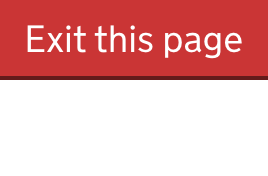
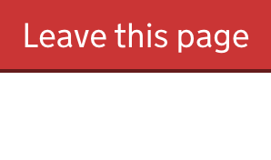

<!-- Generated from src/GovUk.Frontend.AspNetCore.Docs/Templates/components/exit-this-page.liquid -->
# Exit this page

[GOV.UK Design System exit this page component](https://design-system.service.gov.uk/components/exit-this-page/)


## Tag helpers

### Example


```razor
<govuk-exit-this-page />
```


### Example with custom text and redirect URL


```razor
<govuk-exit-this-page redirect-url="https://www.gov.uk/">
    <span class="govuk-visually-hidden">Emergency</span> Leave this page
</govuk-exit-this-page>
```


### API

#### `<govuk-exit-this-page>`

The content is the HTML to use within the exit this page button. If there is no content, the button says "Exit this page" with a visually hidden "Emergency" prefix.

| Attribute | Type | Description |
| --- | --- | --- |
| `activated-text` | `string` | The text announced by screen readers when the exit this page keyboard shortcut has been activated. If not specified, the govuk-frontend JavaScript default is used. |
| `press-one-more-time-text` | `string` | The text announced by screen readers when the user must press `Shift` one more time to activate the button. If not specified, the govuk-frontend JavaScript default is used. |
| `press-two-more-times-text` | `string` | The text announced by screen readers when the user must press `Shift` two more times to activate the button. If not specified, the govuk-frontend JavaScript default is used. |
| `redirect-url` | `string` | The URL that the exit this page button redirects to. The default is `"https://www.bbc.co.uk/weather"`. |
| `timed-out-text` | `string` | The text announced by screen readers when the keyboard shortcut has timed out without successful activation. If not specified, the govuk-frontend JavaScript default is used. |

