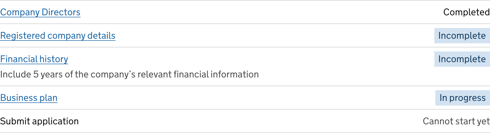
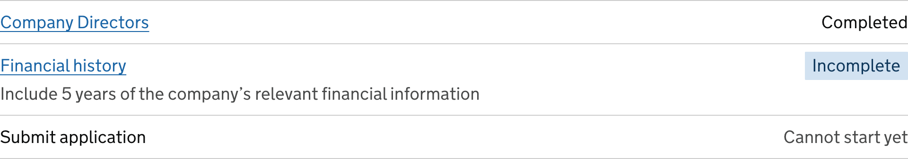

<!-- Generated from src/GovUk.Frontend.AspNetCore.Docs/Templates/components/task-list.liquid -->
# Task list

[GOV.UK Design System task list component](https://design-system.service.gov.uk/components/task-list/)


## Tag helpers

Each task's title links to its `href`, which you can also generate with the `asp-*` attributes (see [Links](../links.md)).
Leave the link out for a task the user can't start yet.

To show a task's status as a tag, put a `<govuk-tag>` inside the status element.

### Example


```razor
<govuk-task-list>
    <task-list-item href="#">
        <task-title>Company Directors</task-title>
        <status>Completed</status>
    </task-list-item>
    <task-list-item href="#">
        <task-title>Registered company details</task-title>
        <status>
            <govuk-tag class="govuk-tag--blue">Incomplete</govuk-tag>
        </status>
    </task-list-item>
    <task-list-item href="#">
        <task-title>Financial history</task-title>
        <hint>Include 5 years of the company’s relevant financial information</hint>
        <status>
            <govuk-tag class="govuk-tag--blue">Incomplete</govuk-tag>
        </status>
    </task-list-item>
    <task-list-item href="#">
        <task-title>Business plan</task-title>
        <status>
            <govuk-tag class="govuk-tag--light-blue">In progress</govuk-tag>
        </status>
    </task-list-item>
    <task-list-item>
        <task-title>Submit application</task-title>
        <status class="govuk-task-list__status--cannot-start-yet">Cannot start yet</status>
    </task-list-item>
</govuk-task-list>
```


### Example with long tag names


```razor
<govuk-task-list>
    <govuk-task-list-item asp-controller="Home" asp-action="Index">
        <govuk-task-list-item-title>Company Directors</govuk-task-list-item-title>
        <govuk-task-list-item-status>Completed</govuk-task-list-item-status>
    </govuk-task-list-item>
    <govuk-task-list-item href="#">
        <govuk-task-list-item-title>Financial history</govuk-task-list-item-title>
        <govuk-task-list-item-hint>Include 5 years of the company’s relevant financial information</govuk-task-list-item-hint>
        <govuk-task-list-item-status>
            <govuk-tag class="govuk-tag--blue">Incomplete</govuk-tag>
        </govuk-task-list-item-status>
    </govuk-task-list-item>
    <govuk-task-list-item>
        <govuk-task-list-item-title>Submit application</govuk-task-list-item-title>
        <govuk-task-list-item-status class="govuk-task-list__status--cannot-start-yet">Cannot start yet</govuk-task-list-item-status>
    </govuk-task-list-item>
</govuk-task-list>
```


### API

#### `<govuk-task-list>`

| Attribute | Type | Description |
| --- | --- | --- |
| `id-prefix` | `string` | The prefix for the `id` attributes of each item's hint and status. If not specified, `task-list` will be used. |


#### `<task-list-item>` / `<govuk-task-list-item>`

Must be inside a `<govuk-task-list>` element.

| Attribute | Type | Description |
| --- | --- | --- |
| (link attributes) |  | See [documentation on links](../links.md) for more information. |


#### `<task-title>` / `<govuk-task-list-item-title>`

The content is the HTML to use within the task's title.

Must be inside a `<task-list-item>` or `<govuk-task-list-item>` element.


#### `<hint>` / `<govuk-task-list-item-hint>`

The content is the HTML to use within the task's hint.

Must be inside a `<task-list-item>` or `<govuk-task-list-item>` element.


#### `<status>` / `<govuk-task-list-item-status>`

The content is the HTML to use within the task's status.

Must be inside a `<task-list-item>` or `<govuk-task-list-item>` element.

